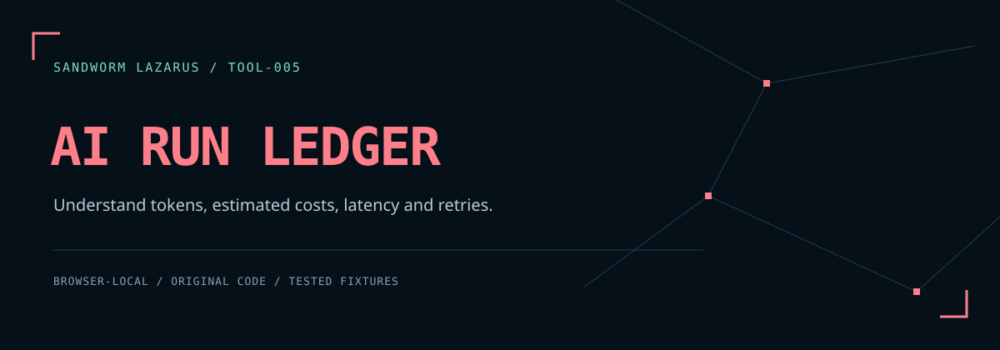

# Sandworm AI Run Ledger



A browser-local ledger for AI run logs. Import JSON/JSONL, supply your own token rates, and inspect estimated USD cost, token totals, retries, errors, and nearest-rank latency percentiles. No model API, account, upload service, or runtime dependency is required.

[คู่มือภาษาไทย](README.th.md) · [Threat model](docs/THREAT_MODEL.md) · [Development](docs/DEVELOPMENT.md)

## Run

```sh
python3 -m http.server 8080 --bind 127.0.0.1 --directory dist
```

Open `http://127.0.0.1:8080`. Node.js 20+ can run `npm test`, `npm run verify` and `npm run check`; `npm run serve` invokes the same Python server. All fonts, artwork, code and notices are included. There is no dependency installation or build step. SHA-256 export needs a browser secure context such as localhost or HTTPS; direct `file://` operation is not a verified compatibility promise.

Select **ลองข้อมูลสมมติ**, then **วิเคราะห์ log**. The twelve sample attempts and their two model names/rates are fabricated, not measurements or current provider prices.

## Input contract

A JSON array, or one JSON object per line (JSONL):

```json
[{"id":"run-001","model":"my-model","input_tokens":800,"output_tokens":120,"latency_ms":900,"status":"success","retry":false}]
```

| Field | Accepted value |
| --- | --- |
| `id` | Unique, nonempty string; 1–100 UTF-16 code units, no surrounding whitespace, control or bidi override characters |
| `model` | Nonempty exact-match label with the same string limits; names are case sensitive |
| `input_tokens`, `output_tokens` | Integer from 0 to 1,000,000,000 |
| `latency_ms` | Integer from 0 to 86,400,000, including zero |
| `status` | `success` or `error` |
| `retry` | Optional boolean; defaults to false |

Each record is **one attempt**, including failed/retried attempts. A retry needs its own ID. Request chains, missing attempts, cached tokens and billing semantics are not inferred. Unknown fields are discarded before aggregation; they are not included in any report. Maximum: 1 MiB UTF-8, 5,000 records and 100 model labels. Blank JSONL lines and a UTF-8 BOM are accepted. Parsing uses standard `JSON.parse`: duplicate keys within an object use the last value; prevalidate upstream logs if duplicate-key detection is required. Duplicate *run IDs* are rejected.

Manual rate card (USD per million tokens):

```json
[{"model":"my-model","input_usd_per_million":0.25,"output_usd_per_million":1.25}]
```

Use `[]` when no rates are known. The card allows up to 200 unique model entries with finite rates between 0 and 10,000. Zero is an explicit known free rate. Missing model prices are **unknown**, not zero.

## Calculations

- Known cost = sum of `(input_tokens × input_rate + output_tokens × output_rate) / 1,000,000` across all priced attempts, including errors and retries. Floating-point arithmetic is rounded to 12 decimal places in USD; it is not a billing/accounting system.
- Total estimate is `null` if any selected attempt has an unknown price. The known subtotal and number of unpriced attempts are shown separately.
- Error rate = error attempts / all recorded attempts.
- Retry count = records explicitly marked `retry: true`.
- Latency p50/p95 uses nearest rank: sorted value at `ceil(p × n)` (one-based). Every recorded attempt, including errors, is included. These are recorded latencies, not measurements taken by the app.
- Filters select one model or all models; the review confirmation is cleared on filter changes.

Cache/batch discounts, tax, subscriptions, tool charges, audio/image pricing and other fees are not modeled. Update your manual rates and input schema before interpreting the estimate as your provider's bill.

## Privacy and reproducibility

Logs stay in page memory. The application uses no network calls, persistent storage, analytics or external fonts. The UI renders log-derived labels with `textContent`, masks conventional ASCII email-like strings in model labels, and removes other unsupported label characters. This is not a general personal-data detector.

The JSON export omits all raw model labels and record IDs: models become `model-001`, `model-002`, etc., assigned by sorted original label. It includes aggregate metrics, the selected scope, numeric rates, engine version, exact-input SHA-256 and exact-rate-card SHA-256. Unknown fields, prompts and credentials are never copied to that report. Aliases can shift when the input model set changes. Aggregates and hashes can still reveal information; review before sharing. A fingerprint is not encryption, a signature, or proof that an input was truthful.

Any input/rate edit clears the result. Export is gated by a fresh review checkbox; asynchronous file reading and export use revision checks to prevent stale downloads. The tool does not securely erase memory or protect against browser extensions/compromised hosts.

## Engine API

```js
const ledger = require('./dist/ledger.js');
const result = ledger.analyze(runText, rateText);
const report = await ledger.createReport(runText, rateText, 'all');
```

`analyze` returns display-safe model labels and metrics. `createReport` is the privacy-reduced export boundary. Do not export the entire `analyze` result when model-label anonymity is required.

## Project scope and license

Original Sandworm application and network artwork with a dark coral theme aligned to [Sandworm Lazarus](https://sandworm-lazarus.pages.dev/). Application code: MIT. Embedded Chakra Petch, Anuphan and JetBrains Mono fonts: SIL OFL 1.1; see [third-party notices](THIRD_PARTY_NOTICES.md). This prototype is an offline analysis aid, not a live model benchmark or invoice verifier.

## Sandworm tools

[Skill Doctor](https://github.com/Sandworm-Lazarus/sandworm-skill-doctor) · [Thai Eval Studio](https://github.com/Sandworm-Lazarus/sandworm-thai-eval) · [GameGuard Lab](https://github.com/Sandworm-Lazarus/sandworm-gameguard-lab) · [Agent Gate](https://github.com/Sandworm-Lazarus/sandworm-agent-gate) · [Privacy Workbench](https://github.com/Sandworm-Lazarus/sandworm-privacy-workbench)
