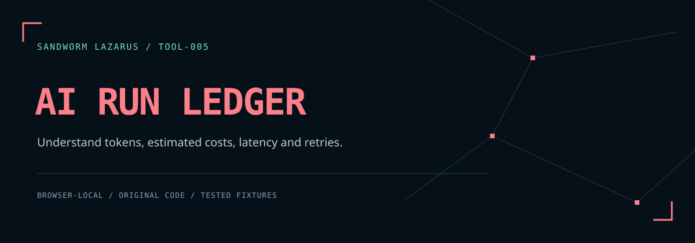

# Sandworm AI Run Ledger



เครื่องมือวิเคราะห์ log การเรียก AI ภายในเบราว์เซอร์ แสดง token, ต้นทุนประมาณจากราคาที่คุณกำหนด, error, retry และ latency P50/P95 ไม่มีการเชื่อมต่อบริการโมเดลหรืออัปโหลด log

[English / schema ฉบับเต็ม](README.md) · [ขอบเขตความปลอดภัย](docs/THREAT_MODEL.md)

## เปิดใช้งาน

```sh
python3 -m http.server 8080 --bind 127.0.0.1 --directory dist
```

เปิด `http://127.0.0.1:8080` กด **ลองข้อมูลสมมติ** แล้ว **วิเคราะห์ log** ตัวอย่าง 12 attempts, ชื่อโมเดล และราคาทั้งหมดเป็นข้อมูลสมมติ ไม่ใช่ผลทดสอบโมเดลจริง

มี Node.js 20+ สามารถใช้ `npm test`, `npm run verify` และ `npm run check` ได้ ไม่ต้องติดตั้ง dependency ฟอนต์และภาพรวมอยู่ในโปรเจกต์แล้ว การส่งออก SHA-256 ต้องใช้เบราว์เซอร์ที่รองรับ secure context เช่น localhost หรือ HTTPS

## เตรียมข้อมูล

Run log รับ JSON array หรือ JSONL (หนึ่ง object ต่อบรรทัด):

```json
[{"id":"r1","model":"demo-model","input_tokens":800,"output_tokens":120,"latency_ms":900,"status":"success","retry":false}]
```

- ทุก attempt มี `id` ไม่ซ้ำกัน และ `model` เป็นข้อความ 1–100 ตัวแบบ UTF-16
- token เป็นจำนวนเต็ม 0–1,000,000,000; latency เป็นจำนวนเต็ม 0–86,400,000 มิลลิวินาที
- `status` เป็น `success` หรือ `error`; `retry` เป็น boolean และละได้
- จำกัด 1 MiB, 5,000 attempts, 100 โมเดล ชื่อโมเดลตรงกันทุกตัวอักษร
- ฟิลด์อื่น เช่น prompt หรือ API key ไม่ถูกนำไปใส่รายงาน
- ใช้ JSON parser มาตรฐาน: ถ้าคีย์ใน object ซ้ำจะใช้ค่าตัวสุดท้าย แต่ ID ซ้ำข้ามรายการจะถูกปฏิเสธ

Rate card เป็น JSON array ราคา USD ต่อหนึ่งล้าน token:

```json
[{"model":"demo-model","input_usd_per_million":0.25,"output_usd_per_million":1.25}]
```

ถ้ายังไม่ทราบราคาใช้ `[]` ได้ ราคาศูนย์หมายถึงทราบว่าเป็นศูนย์; การไม่มีราคาจะถือว่า **ยังไม่ทราบ** และไม่รายงานยอดรวมปลอมเป็นศูนย์

## วิธีอ่านผล

หนึ่งรายการคือหนึ่ง attempt รวมทั้ง error และ retry จึงรวมต้นทุนของ error ด้วยถ้ามี token ใน log แอปไม่เดาว่าเป็นการ retry คำขอใด และไม่เดาว่า failed request ฟรี

ต้นทุน = `(input tokens × input rate + output tokens × output rate) / 1,000,000` ถ้าบางรายการขาดราคา จะแยกยอดที่ทราบกับจำนวนรายการที่ยังไม่มีราคา ไม่รวมภาษี ส่วนลด cache/batch ค่าสมาชิก และค่าบริการเพิ่มเติม

Error rate = error attempts / attempts ทั้งหมด ส่วน P50/P95 ใช้ nearest-rank จาก latency ของทุก attempt รวม error ไม่ใช่ค่าเฉลี่ย และไม่ใช่ latency ที่แอปนี้ไปวัดบริการเอง

เลือกกรองโมเดลได้ หลังเปลี่ยนตัวกรองต้องตรวจทานก่อนส่งออกอีกครั้ง การแก้ log หรือ rate card จะล้างผลเดิม

## รายงานและความเป็นส่วนตัว

กดยืนยันตรวจทานแล้วดาวน์โหลด JSON รายงานใช้ alias `model-001` แทนชื่อโมเดล ไม่ส่งออก ID, prompt หรือชื่อไฟล์ รายงานระบุ rate card แบบตัวเลข, วิธีคำนวณ, เวอร์ชัน engine และ SHA-256 ของข้อมูลต้นฉบับกับ rate card

SHA-256 เป็นลายนิ้วมือ **ไม่ใช่การเข้ารหัส** และไม่พิสูจน์ว่าข้อมูลจริง ผลรวมและ hash ยังอาจเปิดเผยข้อมูลได้ ควรตรวจรายงานก่อนแชร์ ชื่อโมเดลบนหน้าจอปิดบังเฉพาะอีเมลทั่วไป ไม่ใช่เครื่องมือปิดบังข้อมูลส่วนบุคคลทุกชนิด

ข้อมูลอยู่ในหน้านี้ ไม่บันทึกประวัติใน storage แต่ไม่รับรองการลบข้อมูลจาก RAM หรือการป้องกัน browser extension

โค้ด MIT; ฟอนต์ SIL OFL 1.1 ตาม [THIRD_PARTY_NOTICES.md](THIRD_PARTY_NOTICES.md)

## Sandworm tools

[Skill Doctor](https://github.com/Sandworm-Lazarus/sandworm-skill-doctor) · [Thai Eval Studio](https://github.com/Sandworm-Lazarus/sandworm-thai-eval) · [GameGuard Lab](https://github.com/Sandworm-Lazarus/sandworm-gameguard-lab) · [Agent Gate](https://github.com/Sandworm-Lazarus/sandworm-agent-gate) · [Privacy Workbench](https://github.com/Sandworm-Lazarus/sandworm-privacy-workbench)

## ดูขั้นตอน Agent ด้วย Langfuse

ส่วน **AGENT TRACE** รับ JSON จาก Python worker ของเรา แล้วกางต้นไม้ parent–child เพื่อดูว่าแต่ละขั้นตอนเริ่มเมื่อไร ใช้เวลาเท่าไร มี token, ต้นทุน และคะแนนประเมินใดผูกอยู่ กดลอง trace สมมติได้ทันที หรือรัน `integrations/langfuse/trace_export.py` กับเซิร์ฟเวอร์ของคุณแล้วนำผลกลับมาเปิด

ต้นทุนส่วนนี้เป็นค่าที่ Langfuse บันทึกไว้ รวมเฉพาะ GENERATION เพื่อไม่รวมยอด parent ซ้ำ แยกจากราคาประมาณที่คุณกำหนดเองใน Run Analysis ชื่อ/ID ต้นฉบับใช้ alias แต่ยังคงสายสัมพันธ์ หาก parent หรือราคาหายจะแสดงให้เห็น คะแนนคงสเกลเดิมและไม่เฉลี่ยข้ามเกณฑ์ หน้าเว็บไม่รับ API key และไม่เชื่อมเครือข่าย ดู [คู่มือและตัวอย่าง instrumentation](integrations/langfuse/README.md)
